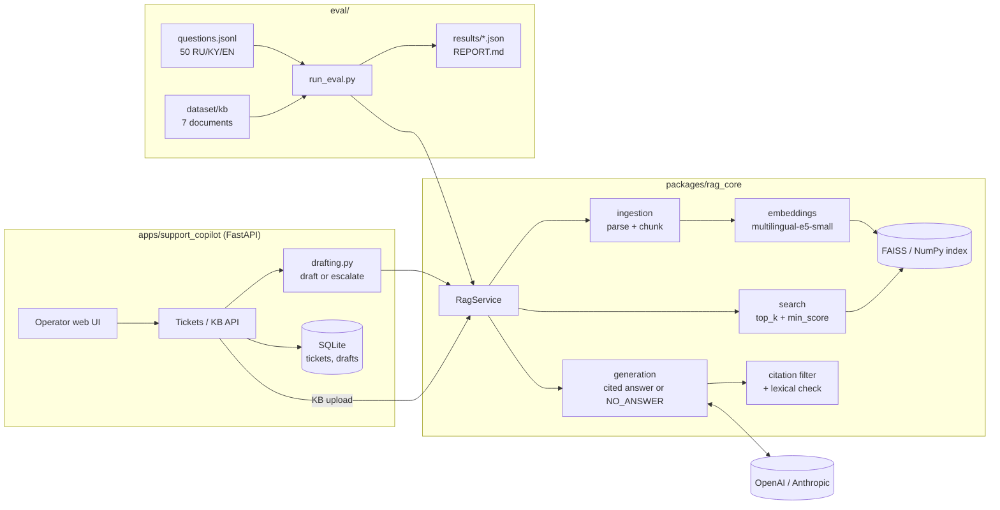

# RAG Support Platform

A multilingual (Russian / Kyrgyz / English) retrieval-augmented generation engine and a
customer-support copilot built on top of it, with an evaluation harness that measures
retrieval, answer quality, citation grounding, refusals and latency.

- **`packages/rag_core`** — the engine: document ingestion (TXT/MD/PDF), chunking,
  multilingual embeddings (`intfloat/multilingual-e5-small`), FAISS/NumPy vector index,
  answer generation with numbered `[n]` citations, the `NO_ANSWER` protocol, removal of
  citations that point nowhere and a lexical citation check. Ships its own small web UI
  (`rag_core.api`) for uploading documents and asking questions.
- **`apps/support_copilot`** — a FastAPI + SQLModel service for support operators: tickets,
  reply drafts grounded in the knowledge base, statuses, and automatic escalation when the
  knowledge base has no answer. Uses `rag_core` as a library.
- **`eval/`** — a 50-question benchmark over a fictional online store and `run_eval.py`,
  which reports Recall@5, answer accuracy, citation validity, NO_ANSWER precision/recall,
  hallucination rate and latency. Works without an API key in retrieval-only mode.

## Architecture



Request path for a ticket: the copilot sends the customer's question to `RagService.ask()`;
the engine retrieves the top-5 chunks above `min_score`, asks the LLM to answer only from
those numbered sources, drops replies without a valid citation, and returns the answer with
its citations. If nothing relevant is found or the model replies `NO_ANSWER`, the copilot
escalates the ticket to a human instead of drafting a reply.

## Quick start

Requires Python 3.12+ (developed on 3.13). On Linux install CPU-only torch first
(`pip install torch --index-url https://download.pytorch.org/whl/cpu`) to avoid several GB
of CUDA libraries.

```bash
python -m venv .venv
.venv\Scripts\activate            # Linux/macOS: source .venv/bin/activate
pip install -r requirements-dev.txt   # installs rag-core and support-copilot (editable) + dev tools
```

Configuration lives in a `.env` per package (copy the `.env.example` next to it):

| File | Used by | Key settings |
|---|---|---|
| `packages/rag_core/.env` | engine web UI, `eval/run_eval.py` | `LLM_PROVIDER`, `OPENAI_API_KEY` / `ANTHROPIC_API_KEY`, `APP_PASSWORD` |
| `apps/support_copilot/.env` | copilot | same LLM settings, `COMPANY_NAME` |

Without an API key both apps run in retrieval-only mode (search works, no generated answers;
the copilot escalates every ticket).

### LLM providers

`LLM_PROVIDER=openai` talks to any OpenAI-compatible API: set `LLM_BASE_URL` and `LLM_MODEL`,
and put that provider's key in `OPENAI_API_KEY`. Leave `LLM_BASE_URL` empty for OpenAI itself.

| Provider | `LLM_BASE_URL` | `LLM_MODEL` (example) | Free tier |
|---|---|---|---|
| OpenAI | _(empty)_ | _(empty = default)_ | no |
| Groq | `https://api.groq.com/openai/v1` | `llama-3.3-70b-versatile` | yes, per-minute and daily limits |
| Gemini | `https://generativelanguage.googleapis.com/v1beta/openai/` | `gemini-2.5-flash` | yes, ~10 requests/min |
| Anthropic | — (`LLM_PROVIDER=anthropic`, `ANTHROPIC_API_KEY`) | _(empty = default)_ | no |

```env
# packages/rag_core/.env — example for Groq
LLM_PROVIDER=openai
LLM_BASE_URL=https://api.groq.com/openai/v1
LLM_MODEL=llama-3.3-70b-versatile
OPENAI_API_KEY=<your Groq key>
```

Compatible hosts get only portable request parameters (`max_tokens`, no `reasoning_effort`).
An exhausted balance (`insufficient_quota`, "no credits") is reported as `quota`, a
per-minute limit as `rate_limit`.

Run the apps:

```bash
uvicorn support_copilot.main:app --reload     # copilot, from apps/support_copilot
python apps/support_copilot/demo/seed.py --reset   # demo tickets for the electronics shop
uvicorn rag_core.api.app:app --reload         # engine UI, from packages/rag_core
```

Tests (each suite runs in its own process):

```bash
python scripts/run_tests.py
```

Evaluation:

```bash
python eval/run_eval.py --mode retrieval      # no key needed
python eval/run_eval.py --mode full           # needs an LLM key; ~50 LLM calls
python eval/run_eval.py --mode full --llm-judge   # + model-graded accuracy (~86 calls)
python eval/run_eval.py --mode full --delay 7     # free tiers: slower, stays under the RPM limit
python eval/compare_retrieval.py              # dense vs BM25 vs hybrid, no key needed
```

Full mode pauses `--delay` seconds (default 2) before every LLM call and retries a
rate-limited call up to `--max-retries` times (default 4) with 5/10/20/40 s backoff. If the
first three questions all fail (wrong key, no balance), the run stops without writing results.

## Quality

<!-- metrics:start -->
Retrieval-only run, 2026-11-03: 50 questions (36 answerable, 14 NO_ANSWER; RU/KY/EN),
7 documents, `multilingual-e5-small`, top_k=5, min_score=0.75. Details:
[eval/REPORT.md](eval/REPORT.md).

| Metric | Value |
|---|---|
| Retrieval Recall@5 | 97.2% (35/36; RU 96%, KY 100%, EN 100%) |
| Retrieval MRR | 0.908 |
| Retrieval gate: refusal recall | 0% (all 14 NO_ANSWER questions pass `min_score`) |
| Retrieval gate: false refusals | 0% |
| Search latency p50 / p95 | 23 / 27 ms (CPU) |
| Answer accuracy, citation validity, NO_ANSWER P/R, hallucination rate | not measured yet — need a full run with an LLM key |
<!-- metrics:end -->

**Dense vs hybrid.** rag_core retrieves with dense embeddings only. An experiment in
`eval/compare_retrieval.py` adds BM25 and reciprocal-rank fusion on the same chunks
([full table](eval/RETRIEVAL_COMPARISON.md)):

| Dataset | Dense R@5 / MRR | BM25 R@5 / MRR | Hybrid R@5 / MRR |
|---|---|---|---|
| store (36 q, RU/KY/EN) | **97.2% / 0.911** | 91.7% / 0.851 | 91.7% / 0.887 |
| hr (24 q, RU/EN) | 95.8% / **0.964** | 95.8% / 0.900 | **100% /** 0.933 |

Hybrid fixes one English question in one set and breaks two English questions in the other
(BM25 cannot match English questions to Russian text). With 13–15 chunks per knowledge base
the sets are too small to justify switching; dense stays the default.

## Honest limitations

- **Small benchmark.** 50 questions over 7 short documents of one fictional store; one
  question moves a metric by 2–3 points. It catches regressions, it does not prove quality
  on a real knowledge base.
- **Lexical checks.** Answer accuracy compares key facts (mostly numbers) by string match,
  and citation validity is a word/number overlap test. Both miss paraphrases, and citation
  validity cannot judge answers written in a different language from the source document.
  `--llm-judge` adds a model-graded accuracy, but the judge is the same model family.
- **Single process, local storage.** The index is a file on disk guarded by an in-process
  lock; the copilot uses SQLite. Neither scales past one worker without changes.
- **No reranker, no hybrid search in the engine.** Retrieval is dense-only with a fixed
  `min_score` threshold calibrated for `multilingual-e5-small`; another model needs
  re-tuning. The threshold does not separate unanswerable on-topic questions (see
  eval/REPORT.md): refusing them is the LLM's job.
- **Kyrgyz** is supported through the multilingual embedding model and the LLM, not through
  any Kyrgyz-specific processing.
- Not deployed yet; Dockerfiles exist for both apps (`docker build -f
  apps/support_copilot/Dockerfile .` from the repo root).

## Repository layout

```
packages/rag_core/       engine package + its 291 tests + sample HR documents
apps/support_copilot/    copilot service + 78 tests + demo knowledge bases and seed script
eval/                    benchmark dataset, run_eval.py, compare_retrieval.py, results/,
                         REPORT.md, RETRIEVAL_COMPARISON.md, tests
scripts/run_tests.py     runs every test suite
requirements-dev.txt     one-command install of the whole workspace
```
